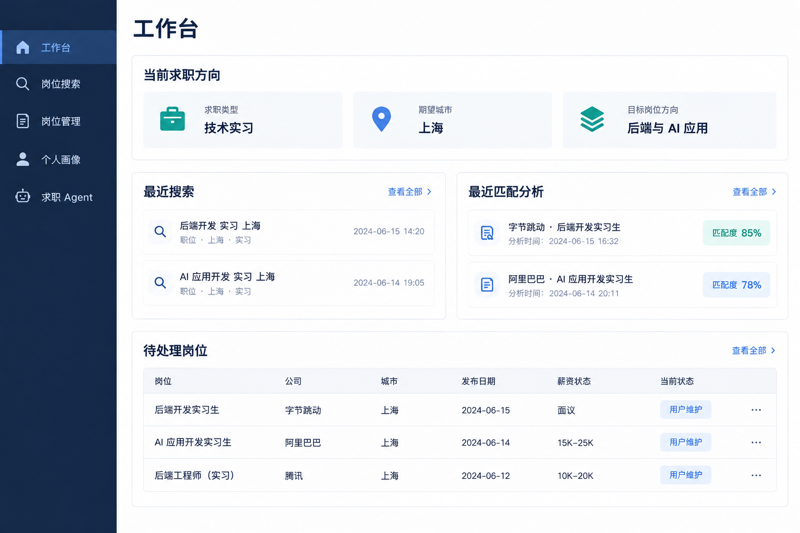
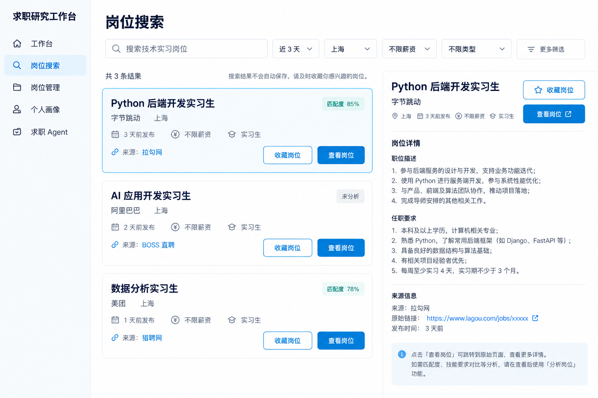
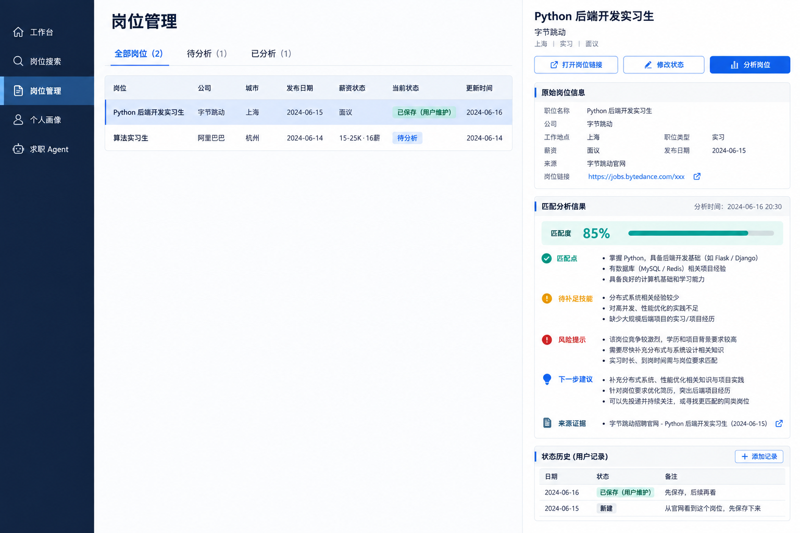
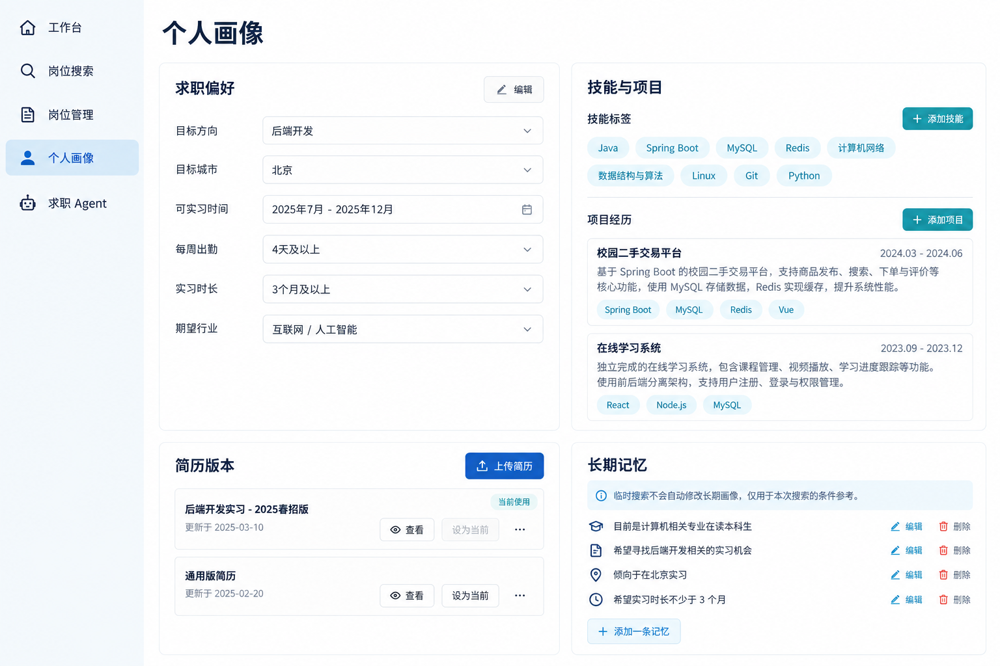
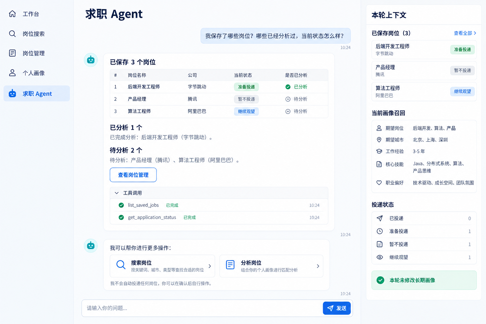

# 岗位分析 Agent 产品需求文档

## 1. 文档信息

- 项目名称：Job Analysis Agent
- 项目目录：job_analysis_agent/
- 产品形态：本地单用户 Web 应用
- 目标用户：寻找中国技术类校园实习岗位的个人用户
- 文档状态：MVP 设计基线
- 后续产品演进：见 [v0.2.0 产品需求](PRD-v0.2.0.md)，作为 MVP 之后的阶段需求基准

## 文档分工

- 本文件：产品目标、业务边界、页面规划、API 能力和 MVP 验收标准。
- [v0.2.0 产品需求](PRD-v0.2.0.md)：MVP 之后的工作台、推荐、订阅和 Agent 协作需求与版本路线。
- [实施计划](IMPLEMENTATION_PLAN.md)：按阶段拆分的开发顺序和验收标准。
- [技术架构设计](design/architecture.md)：技术选型、代码分层、Provider、Agent 和运行流程的实现约束。
- [数据模型设计](design/data-model.md)：表结构、字段类型、主外键、唯一约束、状态生命周期和数据保留规则。
- [API 契约](design/api-contract.md)：请求、响应、错误码、分页和 SSE 事件格式。

实现代码以后两份设计文档为技术约束；如果产品需求和技术设计发生冲突，以本文件中最新确认的产品决策为准，并同步更新设计文档。

## 2. 产品定位

岗位分析 Agent 是一个面向个人求职者的岗位研究工作台。它不负责自动投递，而是帮助用户完成：

~~~text
发现岗位
→ 筛选岗位
→ 保存岗位
→ 分析岗位与个人经历的匹配度
→ 管理投递流程
→ 记录面试和状态变化
→ 根据长期求职偏好持续优化搜索
~~~

产品重点不是简单展示招聘网站结果，而是把岗位数据、候选人画像、简历经历和 LLM 分析组合成可解释的求职决策辅助工具。

## 3. 已确认的产品决策

### 3.1 用户和范围

- 第一版只面向个人用户，不做账号体系和多租户。
- 第一版只关注中国技术类校园实习岗位。
- 优先岗位方向包括后端、前端、AI 应用、算法、数据分析、测试等技术岗位。
- 数据模型保持可扩展，后续可以增加其他岗位类别和海外岗位，但不纳入第一阶段验收。

### 3.2 投递边界

- 不自动投递简历。
- Agent 只负责搜索、分析、推荐、简历修改建议、面试准备和打开官方投递链接。
- 用户自己通过岗位原始链接完成投递。
- 投递状态、状态时间和备注由用户维护。

### 3.3 分析策略

- 先使用确定性规则完成硬条件筛选。
- 用户主动选择岗位后，才调用 LLM 进行语义匹配。
- LLM 不直接决定所有结果，必须结合规则筛选结果和可追溯证据。
- 报告使用精简结构化 JSON，页面不依赖自由格式 Markdown 作为核心数据源。

## 4. 第一阶段目标

1. 输入关键词、城市和筛选条件，搜索技术类校园实习岗位。
2. 支持 Fixture、手动导入和至少一个合规 Provider。
3. 对岗位进行标准化、去重和来源标记。
4. 保存岗位主表和岗位快照。
5. 用户可以收藏岗位。
6. 用户可以自定义投递状态、状态时间和备注。
7. 用户可以维护求职偏好、在线简历和附件简历；上传 PDF/DOCX 后可自动解析成在线简历草稿。
8. 用户选择岗位后生成岗位匹配分析。
9. 画像信息不足时，Agent 可以先反问用户。
10. 用户确认后，Agent 才能把稳定信息保存为长期画像记忆。
11. 岗位管理页统一展示收藏岗位、岗位详情、匹配结果、风险和下一步建议。
12. 岗位来源、抓取日期、发布日期和分析时间可追溯。

## 5. 非目标

第一阶段明确不实现：

- 自动投递简历。
- 绕过招聘网站登录、验证码或反爬机制。
- 未授权抓取招聘网站页面。
- 多用户注册、登录、权限和团队协作。
- 复杂的异步任务队列、Redis、Celery、Kafka。
- 复杂向量数据库和无限制对话记忆。
- 复杂求职统计、通知和定时提醒。
- 自动判断用户长期意图并静默修改画像。

## 6. 岗位来源和 Provider

### 6.1 来源原则

Provider 只允许合规来源：

- 官方开放 API。
- 官方授权 Feed 或合作接口。
- 用户主动粘贴的官方岗位链接或岗位描述。
- 本地 Fixture 数据。

不使用未授权的页面批量抓取、账号模拟登录或绕过平台限制的接口。

### 6.2 第一阶段 Provider

~~~text
JobProvider
├── ShixisengProvider
├── FixtureProvider
└── ManualImportProvider
~~~

#### ShixisengProvider

实习僧提供官方开放平台和实习岗位搜索接口，可按关键词、城市、日薪、每周工作天数、实习月份、学历、行业和岗位类型等条件查询。接入需要按照官方文档申请商户身份、App ID、App Secret，并遵守签名、授权头和 IP 白名单要求。

官方文档：[实习僧开放平台](https://open.shixiseng.com/)

配置：

~~~env
JOB_PROVIDER=fixture
SHIXISENG_APP_ID=
SHIXISENG_APP_SECRET=
~~~

没有凭据时，项目必须通过 Fixture 或手动导入模式运行。

#### FixtureProvider

用于离线开发、测试和演示。Fixture 数据必须明确标记为测试数据，不能伪装成真实岗位。

#### ManualImportProvider

后端保留用户提交公开岗位链接并预览、确认后保存的能力。当前第一版搜索页面不展示链接导入入口；求职 Agent 可以读取用户主动提供的公开岗位链接。解析顺序为 JSON-LD、必要时普通浏览器渲染、再由 LLM 基于可见正文按字段证据抽取，适用于不同招聘网站而非某个企业的专用规则。不得登录、绕过验证码、风控或访问限制；LLM 不访问互联网，也不补猜网页没有的信息。预览允许用户校对，确认前不保存。

### 6.3 后续 Provider 扩展

后续可以接入更多高质量岗位来源，但必须新增 Provider，不修改搜索服务的核心接口。候选来源包括企业官方校园招聘网站、学校就业信息网、有授权的校园招聘聚合平台以及其他官方 API 或合作 Feed。

每个 Provider 维护：

~~~text
source_name
source_type
authorization_mode
terms_url
enabled
last_synced_at
quality_status
~~~

## 7. 搜索和筛选

### 7.1 第一版筛选条件

~~~text
关键词
城市
发布日期
学历要求
实习时长
每周出勤天数
薪资状态
是否有转正机会
岗位来源
~~~

暂不实现复杂的公司规模组合条件和复杂薪资区间组合。

第一版搜索范围固定为校园招聘实习岗位，不单独提供“实习生/不限类型”切换；前端以简短说明标明当前范围。后续只有在来源能明确区分日常实习、校招专项实习等类别时，才增加对应筛选。

城市选择交互按省份分组展示，支持热门城市快捷选择、跨省多选、城市/省份关键词搜索和已选城市移除；最多选择 10 个地点，未选择时表示全国范围。目录覆盖 34 个省级行政区下的市级行政区划，包含地级市、自治州、盟和地区，不包含县级市及区县；省份栏和地点列表均可独立滚动。数据依据 [mumuy/data_location](https://github.com/mumuy/data_location) 项目整理，并随前端打包，不要求用户配置地图 API Key，也不在每次打开弹窗时请求第三方服务。目录用于求职搜索筛选，不代替国家行政区划代码库；搜索 API 仍只传地点名称数组，保持现有契约。

### 7.2 发布日期

数据库字段使用 published_date，只保存日期，不保存时分秒。

如果 Provider 返回完整时间，先按北京时间转换，再保存日期：

~~~text
2026-09-18T10:30:00+08:00
→ 2026-09-18
~~~

支持不限、最近 1 天、最近 3 天、最近 7 天和最近 30 天。

选择最近 N 天时：

- 有 published_date：严格按照来源发布日期过滤。
- 没有 published_date：不进入最近 N 天结果。
- 不限日期时：可以展示没有发布日期的岗位，但必须标记日期未知。

### 7.3 薪资

薪资不得由模型猜测。未公开薪资使用空值和状态表示：

~~~text
salary_min = null
salary_max = null
salary_unit = null
salary_status = undisclosed
~~~

页面显示薪资面议或薪资未公开。

筛选模式：

- 不限薪资：包含已公开和未公开薪资。
- 只显示已公开薪资：排除未公开薪资。
- 最低薪资：只匹配明确薪资且满足条件的岗位。

当使用最低薪资筛选时，未公开薪资岗位不作为满足条件的结果，但页面单独统计未公开薪资数量。

## 8. 岗位生命周期

岗位主记录不直接物理删除，仍使用生命周期状态：

~~~text
active
stale
expired
closed
~~~

含义：

- active：Provider 最近仍能获取到，或用户刚刚导入。
- stale：一段时间没有被 Provider 再次确认。
- expired：超过岗位截止日期或来源已明确下线。
- closed：用户手动关闭或不再关注。

历史岗位保留，用户可以查看当时的 JD、来源和匹配分析。

用户可以从“岗位管理”中移除自己的岗位跟踪记录及其状态时间线；该操作不删除岗位主记录、来源快照或岗位匹配分析。这样可以清理个人管理列表，同时保留可复用的来源资料和分析证据。

## 9. 用户自定义投递状态

系统不固定限制状态枚举，可以提供可选模板，但用户拥有最终定义权。

示例状态：

~~~text
已收藏
准备投递
网申已提交
HR 沟通
笔试
一面
二面
终面
Offer
暂不考虑
流程终止
~~~

用户可以设置：

- 状态名称。
- 状态顺序。
- 状态颜色。
- 是否作为终止状态。
- 是否作为成功状态。

每次状态变化都保存事件：

~~~text
from_status
to_status
effective_at
created_at
note
~~~

effective_at 默认当前时间，但允许用户修改；created_at 由系统记录实际写入时间。旧状态事件不删除，前端展示完整时间线。

## 10. 候选人画像、简历和记忆

### 10.1 画像输入

第一版支持手动填写求职偏好、维护当前在线简历，以及上传 PDF/DOCX 附件并自动解析。在线简历采用招聘网站常见的简历中心交互：主区域预览当前简历及基本完整度，各内容区块分别添加或编辑；页面不展示历史版本列表或切换入口。每次保存仍由后端保留简历快照，以便既有岗位分析可以追溯当时依据，但这些内部快照不作为用户可管理的历史版本。简历分区包括基本信息（姓名、联系方式、所在地、学校、专业、学历、毕业年份）、求职意向（岗位、城市、实习类型、到岗时间、每周出勤、期望薪资）、教育经历、校园经历、实习/工作经历、项目经历、技能证书和个人简介。意向岗位和城市使用可搜索的多值标签输入，提供常用建议，同时允许自定义，不要求用户通过逗号拼接。头像、身份证、生日、详细住址等非必要敏感字段不纳入第一版。期望薪资仅是简历展示信息，不作为岗位搜索过滤条件。

附件简历解析流程：本地提取文本 → 本机规则提取姓名、手机号和邮箱并从模型输入中移除 → 对剩余文本中的身份证和详细住址等信息脱敏 → 用户勾选同意后调用当前配置的模型生成教育/经历/项目等结构化草稿 → 将本机提取的基本联系方式合并回草稿 → 用户预览、修改并确认 → 保存为新的在线简历版本。解析结果不自动覆盖现有版本，也不自动修改求职偏好或长期画像记忆。在线简历可从空白表单创建，也可从解析草稿确认创建；编辑已有简历始终另存新版本。

原始附件保存在项目本地文件目录，SQLite 记录附件元数据、解析状态和来源关系。第一版支持可提取文字的 PDF 与 DOCX，最大 10 MB；扫描版 PDF、图片简历和 OCR 暂不支持。用户可查看和删除本地附件，删除附件不会删除已确认的在线简历或历史分析。

### 10.2 记忆分层

岗位 Agent 不使用单一画像 JSON，而使用多层记忆：

~~~text
candidate_profiles
├── profile_facts
├── profile_preferences
├── profile_history
├── conversation_memory
└── memory_index
~~~

保存的结构化信息包括目标岗位、目标城市、可实习时间、可出勤天数、实习时长、技术技能、期望行业、不接受的条件和岗位偏好。

不保存或不发送给 LLM：

~~~text
手机号
邮箱
身份证信息
详细住址
未经用户确认的模型推断
~~~

### 10.3 记忆状态

每条记忆独立维护：

~~~text
active
superseded
deleted
temporary
~~~

例如用户从前端岗位转为后端岗位时，旧的前端偏好标记为 superseded，新后端偏好标记为 active。旧记录保留历史，新记录作为当前默认方向。

### 10.4 记忆写入规则

Agent 只能在以下情况下写入长期记忆：

- 用户明确确认。
- 用户在设置页主动保存。
- 用户直接修改个人画像。

一次临时搜索优先只覆盖本次请求，不自动修改长期画像。如果用户多次搜索新的岗位方向，Agent 可以询问是否切换默认方向。

### 10.5 记忆召回规则

搜索或分析时只召回当前任务需要的信息：

~~~text
本次明确条件 > active 长期偏好 > 系统默认值
~~~

第一版使用 SQLite 结构化查询和关键词检索，不引入向量数据库。后续数据量增加后可以增加 SQLite FTS 或向量召回。

## 11. 岗位匹配分析

### 11.1 两级处理

搜索阶段只执行确定性规则：

~~~text
城市
学历
岗位类型
实习时长
每周出勤
发布日期
薪资状态
关键词
~~~

用户选择岗位后，才执行 LLM 分析：

~~~text
岗位 JD
+ 候选人画像
+ 简历项目经历
→ 结构化匹配结果
~~~

### 11.2 精简分析结果

第一版只保留六类核心字段：

~~~json
{
  "summary": "一句话结论",
  "match_score": 82,
  "recommendation": "strong_match",
  "matched_points": [],
  "missing_points": [],
  "risk_points": [],
  "next_actions": []
}
~~~

推荐枚举：

~~~text
strong_match
match
observe
not_recommended
~~~

数据库可以保存必要的 raw_result 供排查，但前端不展示完整模型上下文。

### 11.3 无画像时的 Agent 反问

当用户提出岗位搜索或岗位分析请求但缺少关键画像时：

~~~text
识别缺失信息
→ 一轮提出少量问题
→ 用户回答
→ 生成画像摘要
→ 用户确认
→ 执行搜索或分析
~~~

## 12. 项目架构

详细技术架构已拆分到 [技术架构设计](design/architecture.md)。本节保留目录摘要，避免产品文档失去整体可读性。

项目沿用学习项目已经验证的分层方式：

### 12.1 前端工具链

前端统一使用以下工具链，不在第一版引入第二套前端框架或状态管理方案：

~~~text
React
TypeScript
Vite
Axios
React Router
Zustand
Tailwind CSS
Lucide React
React Markdown + remark-gfm
Vitest + React Testing Library
ESLint + Prettier
~~~

约束：

- Node.js 使用 LTS 版本，包管理器统一使用 npm。
- React 负责页面和组件，TypeScript 负责前端类型约束。
- Vite 负责开发服务器、环境变量和生产构建。
- Axios 统一封装 REST API 请求、错误处理和超时配置。
- React Router 负责五个核心页面路由，不在组件内部手写页面跳转。
- Zustand 只保存跨页面状态，例如搜索条件、当前选中岗位、当前画像摘要和 Agent 会话引用；表单临时状态保留在页面组件内部。
- Tailwind CSS 负责布局、颜色、响应式和主题样式，不引入第二套 CSS 方案。
- Lucide React 作为统一图标来源，不在页面中混用多个图标库。
- React Markdown 只用于 Agent 的说明性文本和引用展示；岗位匹配核心字段以结构化 JSON 渲染。
- Agent 的 POST SSE 统一使用 `@microsoft/fetch-event-source`，不使用多个并行 SSE 客户端实现。
- 第一版不引入复杂图表库、向量检索前端组件或大型 UI 组件库；统计内容使用表格、标签和进度元素表达。

前端目录职责：

~~~text
apps/web/
├── src/
│   ├── api/          # Axios 实例、API 方法和 SSE 客户端
│   ├── components/   # 跨页面复用组件
│   ├── pages/        # 五个核心页面
│   ├── layouts/      # 左侧导航和页面布局
│   ├── stores/       # Zustand 状态
│   ├── types/        # API 和页面类型
│   ├── hooks/        # 页面复用逻辑
│   ├── styles/       # Tailwind 入口和全局样式
│   └── router/       # React Router 路由配置
├── tests/
├── package.json
├── tsconfig.json
├── vite.config.ts
└── tailwind.config.ts
~~~

标准脚本：

~~~text
npm run dev
npm run build
npm run test
npm run lint
~~~

~~~text
job_analysis_agent/
├── AGENTS.md
├── CLAUDE.md
├── README.md
├── .env.example
├── requirements.txt
├── main.py
├── server.py
├── alembic.ini
├── migrations/
├── api/
│   ├── app.py
│   ├── deps.py
│   └── v1/
│       ├── router.py
│       ├── endpoints/
│       │   ├── health.py
│       │   ├── jobs.py
│       │   ├── applications.py
│       │   ├── profile.py
│       │   ├── agent.py
│       │   └── settings.py
│       └── schemas/
├── src/
│   ├── config.py
│   ├── db/
│   ├── repositories/
│   ├── data_provider/
│   ├── services/
│   ├── core/
│   ├── llm/
│   ├── memory/
│   └── schemas/
├── data/
├── skills/
├── apps/web/
└── tests/
~~~

职责：

- api：HTTP 接口、参数校验和响应契约。
- services：岗位搜索、匹配、状态管理和画像业务逻辑。
- repositories：数据库读写。
- data_provider：不同岗位来源适配和降级。
- core：搜索和匹配流水线编排。
- llm：LiteLLM、Prompt 和结构化输出校验。
- memory：画像记忆提取、召回、确认和替代关系。
- schemas：岗位、画像、匹配报告和 Agent 事件契约。

## 13. 数据库设计概览

详细表结构和关系已拆分到 [数据模型设计](design/data-model.md)。实际创建 SQLAlchemy 模型和 Alembic migration 时，以该文档为准。

数据库采用 SQLite、SQLAlchemy 2.x 和 Alembic。JSON 数据使用 TEXT 保存，写入时序列化，读取时显式解析。

### 13.1 job_sources

保存岗位来源和 Provider 状态：

~~~text
id
name
provider
source_type
authorization_mode
terms_url
enabled
last_synced_at
quality_status
~~~

### 13.2 jobs

保存岗位稳定身份和当前状态：

~~~text
id
source_id
source_job_id
title
company_name
city
district
job_type
salary_min
salary_max
salary_unit
salary_status
education
internship_months
days_per_week
conversion_chance
detail_url
published_date
application_deadline
lifecycle_status
first_seen_at
last_seen_at
created_at
updated_at
~~~

约束：UNIQUE(source_id, source_job_id)。没有来源岗位 ID 时，使用规范化链接和内容哈希辅助去重。

### 13.3 job_snapshots

保存每次同步或导入时的岗位快照：

~~~text
id
job_id
description
requirements
responsibilities
salary_text
raw_payload
content_hash
fetched_at
~~~

### 13.4 job_skills

保存岗位技能标签：

~~~text
id
job_id
skill_name
skill_type
required_level
is_required
source
~~~

### 13.5 candidate_profiles 和 resume_versions

candidate_profiles 保存用于搜索和推荐的候选人背景及长期求职偏好。resume_versions 保存多个在线简历版本；`structured_content` 是 JSON 文本，包含基本信息、求职意向、教育经历、校园经历、实习/工作经历、项目经历、技能证书和个人简介。在线简历是可编辑的结构化资料，不等同于原始附件文件。

### 13.6 profile_facts

保存可独立更新的长期事实：

~~~text
id
profile_id
fact_type
fact_key
fact_value
status
source
confidence
confirmed_at
valid_from
valid_to
created_at
updated_at
~~~

### 13.7 applications

保存用户收藏、岗位状态和投递跟踪关系：

~~~text
id
job_id
profile_id
current_status_id
saved_at
last_status_changed_at
note
created_at
updated_at
~~~

### 13.8 application_status_definitions

保存用户自定义状态：

~~~text
id
profile_id
name
color
sort_order
is_success
is_terminal
enabled
created_at
updated_at
~~~

### 13.9 application_status_events

保存状态变化历史：

~~~text
id
application_id
from_status_id
to_status_id
effective_at
note
created_at
~~~

### 13.10 job_matches

保存岗位匹配结果：

~~~text
id
job_id
profile_id
resume_version_id
match_score
recommendation
matched_points
missing_points
risk_points
next_actions
raw_result
model_used
created_at
~~~

### 13.11 Agent 会话和运行事件

使用 agent_sessions、agent_messages、agent_run_events 保存多轮问职对话和运行流。

事件流：

~~~text
用户请求
→ 读取画像
→ Provider 搜索
→ 岗位标准化
→ 岗位去重
→ 规则筛选
→ 读取 JD
→ LLM 匹配
→ 保存报告
~~~

## 14. 后端 API 规划

详细请求响应契约已拆分到 [API 契约](design/api-contract.md)。本节只保留接口能力索引，实际实现以 API 契约为准。

### 14.1 岗位搜索

~~~text
POST /api/v1/jobs/search
~~~

请求包含关键词、城市、发布日期、岗位类型、学历、实习时长、出勤天数、薪资模式、转正机会和 Provider。

响应包含岗位列表、总数、各 Provider 状态、数据质量摘要、未公开薪资数量和无发布日期数量。

### 14.2 岗位详情和导入

~~~text
GET /api/v1/jobs/{job_id}
POST /api/v1/jobs/import
POST /api/v1/jobs/{job_id}/refresh
~~~

### 14.3 收藏和岗位管理

~~~text
GET /api/v1/applications
POST /api/v1/applications
GET /api/v1/applications/{id}
PATCH /api/v1/applications/{id}
DELETE /api/v1/applications/{id}
POST /api/v1/applications/{id}/status
GET /api/v1/applications/{id}/timeline
PATCH /api/v1/applications/{id}/timeline/{event_id}
~~~

### 14.4 用户画像和记忆

~~~text
GET /api/v1/profile
PUT /api/v1/profile
GET /api/v1/profile/facts
POST /api/v1/profile/facts
PATCH /api/v1/profile/facts/{id}
DELETE /api/v1/profile/facts/{id}
POST /api/v1/profile/confirm
~~~

### 14.5 岗位匹配分析

~~~text
POST /api/v1/jobs/{job_id}/analyze
GET /api/v1/jobs/{job_id}/matches
GET /api/v1/matches/{match_id}
~~~

第一版可以先使用同步接口。后续岗位批量同步量变大，再增加任务队列和 SSE。

### 14.6 问职 Agent

~~~text
GET /api/v1/agent/tools
GET /api/v1/agent/sessions
POST /api/v1/agent/sessions
GET /api/v1/agent/sessions/{session_id}
PATCH /api/v1/agent/sessions/{session_id}
POST /api/v1/agent/chat/stream
POST /api/v1/agent/sessions/{session_id}/runs/{run_id}/cancel
GET /api/v1/agent/sessions/{session_id}/events
POST /api/v1/agent/actions/{event_id}/resolve
~~~

第一版 Agent 工具：

~~~text
search_jobs
list_saved_jobs
get_saved_job_detail
compare_saved_jobs
get_candidate_profile
get_application_status
get_current_resume
analyze_saved_job
propose_save_job
propose_application_update
propose_remove_saved_job
propose_profile_update
propose_resume_update
~~~

Agent 必须遵循：

- 不自动投递。
- 不私自修改长期画像。
- 不把未确认推断写入记忆。
- 不把敏感联系方式发送给 LLM。
- 工具失败时明确返回来源和错误，不编造岗位结果。

## 15. 前端页面规划

第一版主导航只保留五个页面：工作台、岗位搜索、岗位管理、个人画像、求职 Agent。

这是个人单用户工具，不设置登录状态、用户头像、账号问候语或多用户切换。页面标题和功能内容直接进入工作区，避免展示与业务无关的身份信息。

### 15.1 工作台

只展示当前求职方向、城市和岗位偏好、最近搜索、待处理岗位和最近匹配分析。工作台不展示“今日投递”“进入面试”等系统推断统计；如果展示数量，只能来自用户明确保存或修改的数据。

页面不使用“专注你的求职目标”等宣传性副标题，不显示登录问候语。保留简洁标题和可直接操作的内容卡片。

原型图：

### 15.2 岗位搜索页

页面结构：

~~~text
顶部搜索和筛选区
左侧筛选条件
中间岗位列表
右侧选中岗位预览
~~~

岗位卡片展示岗位名称、公司、城市、发布日期、薪资状态、实习周期、出勤要求、转正机会、来源和收藏状态。

岗位搜索页提供“实习岗位”和“校招资讯”两个独立视图。实习岗位沿用岗位库、收藏与分析流程；校招资讯由 Offer 先生官方 API 提供，展示企业公告、届别、招聘批次、岗位类别、城市、网申时间和官方链接。校招资讯是公告级记录，不等同于具体实习职位，不进入 `jobs`、收藏或匹配分析；用户核对公告并找到具体岗位后，可通过公开岗位链接导入流程另行确认保存。

原型图：

### 15.3 岗位管理页

“岗位管理”合并原来的岗位详情与分析页、收藏/投递跟踪页。搜索页中用户点击“收藏岗位”后，岗位进入岗位管理页；岗位不会因为收藏而自动投递，也不会自动改变状态。

页面采用 Tab 组织内容：

~~~text
全部岗位 | 待分析 | 已分析
~~~

岗位列表展示岗位名称、公司、城市、发布日期、薪资状态、当前自定义状态和最近更新时间。选择岗位后，在右侧或下方展示岗位详情。

待分析岗位展示原始岗位信息、来源链接和“分析岗位”按钮；只有用户主动点击后才调用 LLM。已分析岗位展示匹配分、推荐级别、匹配点、缺失点、风险点、下一步动作、分析时间和来源证据。

岗位管理页同时支持：

- 修改用户自定义状态。
- 修改当前或历史状态及其生效日期。
- 添加和编辑备注。
- 展示完整状态时间线。
- 打开官方岗位链接。
- 从个人岗位管理中移除岗位跟踪记录，不删除岗位来源资料和分析历史。
- 重新分析或查看历史分析结果。

状态、时间和备注全部来自用户操作，系统不通过邮件、岗位页面或模型推断“已投递”或“面试中”。

原型图：

### 15.4 个人画像和简历页

求职偏好与在线简历分开展示。在线简历主区域以招聘网站式简历预览为主，按基本信息、求职意向、教育、校园经历、实习/工作经历、项目经历、技能证书和个人简介分区编辑，并显示主要区块完整度。页面只展示当前简历，不展示历史版本列表或切换入口；后端仍保留更新快照供既有岗位分析追溯。用户可从空白创建在线简历；附件简历在侧栏独立上传、下载和删除，可将 PDF/DOCX 自动解析为可编辑草稿。用户确认后设为当前简历；姓名和联系方式只在本机提取/编辑，不发送给模型。解析不得静默覆盖现有偏好或简历，旧版纯文本简历内容仍需可查看和整理。

原型图：

### 15.5 求职 Agent 页

页面保持简洁，不展示宣传性副标题或登录信息。对话上下文按当前任务选择性召回当前岗位、候选人画像、当前简历版本、已保存岗位和投递状态。

支持以下能力：

- 搜索岗位并解释筛选条件和来源。
- 分析用户主动选择的岗位。
- 查询用户已经保存的岗位。
- 查询岗位当前状态、状态时间和备注。
- 查询用户的投递进度概况。
- 对比多个已保存岗位。
- 提供简历修改建议和面试准备建议。
- 画像缺失时先进行一轮反问。

Agent 不自动投递。岗位收藏、状态/备注修改、移除岗位跟踪、画像或简历修改都先生成待确认操作；确认后才写入。待确认操作必须在会话刷新后继续展示；Agent 生成会暂停在确认节点，用户确认或取消后，操作结果交还模型并继续生成本轮回答。待处理期间暂停该会话的新消息输入和发送；若 SSE 已中断，用户处理操作后可主动发送下一条消息继续。被后端拦截的新消息不保存，也不自动重发。移除岗位只删除个人跟踪关系，不物理删除岗位来源数据、快照或分析历史。搜索结果默认临时展示，不写入岗位库。页面可展示简化工具调用和证据来源，但不直接展示原始 JSON。

支持一般求职对话；涉及岗位事实时必须通过工具查证。会话、消息和运行事件保存在本地数据库，用户可新建、重命名、切换历史会话并在原会话继续。多轮上下文使用最近 12 条消息和与当前任务相关的工具证据，不是无限上下文，第一版没有自动摘要压缩。前端通过 SSE 展示运行进度、工具调用、来源结果、待确认操作卡片和逐段到达的回答，不展示模型隐藏推理过程。工具调用过程合并重复的开始/完成事件，显示在本轮回答上方；运行时展开，完成后自动折叠。生成期间输入框保持可编辑；用户可以停止本轮，已输出内容将作为未完成回答保留，再修改输入后继续提问。

原型图：

### 15.6 设置页

第一版包含 LLM 配置、Provider 开关和凭据状态、默认城市和岗位、默认搜索日期范围、记忆开关和主题偏好。

## 16. 运行流和可观测性

岗位搜索和岗位分析都需要形成可追踪的运行记录：

~~~text
run_id
session_id
operation
started_at
completed_at
status
provider_count
model_used
error_message
~~~

Provider 部分失败时：

- 返回其他成功 Provider 的岗位。
- 明确展示失败 Provider。
- 不把“没有结果”和“Provider 失败”混为一谈。
- 不伪造缺失字段。

## 17. LLM Prompt 原则

Prompt 使用分层上下文：

~~~text
系统约束
→ 当前任务
→ 当前岗位快照
→ 规则筛选结果
→ 当前有效画像
→ 用户明确要求
→ 输出 JSON Schema
~~~

LLM 必须：

- 只能基于提供的岗位和画像判断。
- 不得猜测未公开薪资。
- 不得把缺失信息写成确定事实。
- 匹配结论尽量关联岗位要求或用户经历。
- 返回固定结构化结果。
- 分析失败时返回明确不可用状态。

## 18. 隐私和安全

- API Key 只保存在本地 .env，不写入前端代码。
- 简历和画像只保存在本地 SQLite/文件系统。
- 发送给 LLM 前移除手机号、邮箱、身份证和详细住址。
- 附件正文仅在用户主动上传并明确同意解析后，才把脱敏文本发送给当前配置的模型服务；原始文件始终保存在本地。
- 页面展示官方投递链接，但不代替用户登录第三方平台。
- 不自动保存未经用户确认的长期记忆。
- 允许用户查看、修改和删除画像事实。
- Provider 原始响应控制保存范围，避免无必要保存个人信息。

## 19. 实施阶段

### Phase 1：项目骨架和离线闭环

- 独立项目治理文件。
- FastAPI、SQLite、SQLAlchemy、Alembic。
- React Web 基础页面。
- Fixture Provider。
- 岗位搜索、岗位入库和岗位详情。

### Phase 2：画像、收藏和状态跟踪

- 个人画像。
- 简历版本。
- 自定义状态。
- 状态时间线。
- 收藏和岗位管理。

### Phase 3：LLM 岗位分析

- LiteLLM Adapter。
- 规则筛选和结构化岗位匹配。
- 缺失画像时 Agent 反问。
- 用户确认后写入画像记忆。

### Phase 4：真实 Provider

- 实习僧官方 Provider。
- Provider 错误和部分成功。
- 岗位快照更新。
- 来源质量展示。

### Phase 5：求职 Agent 和运行流

- LiteLLM 原生 Tool Calling：真实岗位搜索、已保存岗位/投递进度/画像/当前简历查询、岗位比较和匹配分析。
- 支持一般求职对话、同一会话多轮上下文、新建/重命名/切换历史会话。
- 收藏、状态/备注更新、移除跟踪、画像和简历修改先由用户确认；简历联系方式在本机保留。
- SSE 运行事件和回答持久化；不暴露隐藏推理过程。

## 20. MVP 验收标准

### 数据和搜索

- 能使用 Fixture 数据搜索技术类校园实习岗位。
- 能通过手动导入创建岗位。
- 能按城市、关键词、发布日期和实习条件筛选。
- 最近 N 天筛选只使用 published_date，不把同步时间当发布日期。
- 薪资未公开岗位不会被错误显示为零薪资。
- Provider 失败和无岗位结果可以区分。

### 岗位和投递

- 岗位主表和快照表能保存。
- 相同来源岗位不会重复创建。
- 岗位来源主记录不会因用户移除跟踪关系而被物理删除。
- 用户可以从岗位管理移除岗位跟踪关系及关联状态时间线。
- 用户可以收藏岗位。
- 用户可以创建和修改自定义状态。
- 用户可以修改任意状态事件的状态、生效时间和备注。
- 状态历史可以重新读取。

### 画像和 Agent

- 用户可以维护求职偏好、在线简历和原始附件。
- PDF/DOCX 可解析为结构化草稿；用户确认前不会创建在线简历版本或覆盖偏好。
- 用户没有关键画像时，Agent 会先反问。
- 用户确认后才能保存长期记忆。
- 长期画像支持新增、修改、删除和历史替代。
- 本次搜索条件优先级高于长期画像。
- Agent 可以基于当前岗位和画像生成结构化匹配结果。
- 不会自动投递，也不会伪造岗位或薪资信息。

### 前端

- 五个核心页面可以完成岗位搜索、保存、分析和岗位状态管理。
- 岗位详情中能看到来源链接和分析时间。
- 岗位管理页面能展示岗位详情、匹配分析、自定义状态和时间线。
- Agent 页面能展示运行进度、工具事件、待确认操作卡片和最终回答；不展示隐藏推理过程。
- 设置页可以配置 LLM 和 Provider。

## 21. 主要风险和应对

| 风险 | 应对 |
| --- | --- |
| Provider 没有权限或接口不稳定 | Fixture + 手动导入始终可用 |
| 岗位来源不公开薪资 | 使用 undisclosed，不猜测 |
| 岗位发布时间缺失 | 最近 N 天筛选时排除，普通搜索仍可展示 |
| LLM 过度推荐 | 规则初筛 + 结构化证据 + 风险字段 |
| 用户画像过时 | active/superseded 版本和用户确认 |
| 简历隐私泄露 | 脱敏后再发送 LLM |
| 岗位重复或下线 | 来源 ID、链接、内容哈希和生命周期状态 |
| 对话上下文过长 | 当前岗位上下文 + 选择性记忆召回 |

## 22. 后续可扩展方向

- 更多官方校园招聘 Provider。
- 学校就业网站 Provider。
- SQLite FTS 或向量检索。
- 岗位推荐排序学习。
- 面试题和模拟面试 Agent。
- 求职材料版本管理。
- 邮件或日历提醒。
- 多用户和云端部署。
- 岗位批量同步队列。
