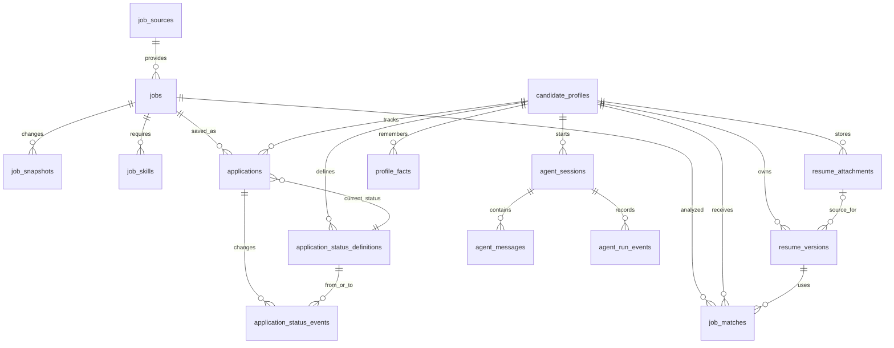

# Job Analysis Agent 数据模型

本文档是 SQLAlchemy ORM 和 Alembic Migration 的数据模型约定。产品需求见 [PRD.md](../PRD.md)，技术分层和业务流程见 [architecture.md](architecture.md)。

## 1. 存储约定

- 数据库：SQLite。
- ORM：SQLAlchemy 2.x。
- 迁移：Alembic。
- 主键：`INTEGER` 自增主键。
- JSON：使用 `TEXT` 保存，写入 `json.dumps`，读取时显式 `json.loads`。
- `published_date`：只保存日期，不保存时分秒；Provider 时间先转换为北京时间。
- 审计时间：`created_at`、`updated_at`、`fetched_at`、`effective_at` 使用 `DATETIME`，应用层统一转换为北京时间展示。
- 布尔值：SQLite 使用 `INTEGER` 0/1，由 SQLAlchemy 映射为 Boolean。
- 所有外键启用索引；删除默认使用业务状态或关系解除，不级联删除岗位历史。
- Offer 先生校招公告只作为临时搜索结果返回，不保存到 `jobs`、`job_snapshots` 或投递跟踪表；公告与具体实习岗位不是同一种业务实体。

## 2. 关系总览



核心关系：

```text
job_sources → jobs → job_snapshots
                   ├→ job_skills
                   ├→ applications → application_status_events
                   └→ job_matches

candidate_profiles → resume_versions
                   → resume_attachments → resume_versions (optional source link)
                   → profile_facts
                   → applications
                   → job_matches
                   → agent_sessions → agent_messages / agent_run_events
```

## 3. 岗位域

### 3.1 `job_sources`

记录来源和 Provider 状态。

| 字段 | 类型 | 约束 | 说明 |
|---|---|---|---|
| `id` | INTEGER | PK | 来源 ID |
| `name` | VARCHAR(64) | NOT NULL | 展示名称 |
| `provider` | VARCHAR(64) | NOT NULL, UNIQUE | Provider 标识 |
| `source_type` | VARCHAR(32) | NOT NULL | official_api、manual、fixture 等 |
| `authorization_mode` | VARCHAR(32) | NOT NULL | official、user_submitted、local |
| `terms_url` | VARCHAR(1000) | NULL | 使用条款链接 |
| `enabled` | BOOLEAN | NOT NULL | 是否启用 |
| `last_synced_at` | DATETIME | NULL | 最近同步时间 |
| `quality_status` | VARCHAR(32) | NOT NULL | healthy、partial、failed |
| `created_at` / `updated_at` | DATETIME | NOT NULL | 审计时间 |

### 3.2 `jobs`

岗位稳定身份和当前可展示信息。搜索结果只保存在进程内临时缓存；只有用户确认保存后才进入此表，并在之后创建 `applications`。

| 字段 | 类型 | 约束 | 说明 |
|---|---|---|---|
| `id` | INTEGER | PK | 岗位 ID |
| `source_id` | INTEGER | FK, INDEX | 来源 |
| `source_job_id` | VARCHAR(255) | NULL | 来源岗位 ID |
| `title` | VARCHAR(300) | NOT NULL | 岗位名称 |
| `company_name` | VARCHAR(200) | NOT NULL | 公司名称 |
| `city` / `district` | VARCHAR(64) | INDEX / NULL | 城市和区域 |
| `job_type` | VARCHAR(64) | NOT NULL | 实习类型或岗位类型 |
| `salary_min` / `salary_max` | REAL | NULL | 明确公开的薪资范围 |
| `salary_unit` | VARCHAR(32) | NULL | 日、月等单位 |
| `salary_status` | VARCHAR(32) | NOT NULL | disclosed、undisclosed、negotiable、unknown |
| `education` | VARCHAR(128) | NULL | 学历要求 |
| `internship_months` | REAL | NULL | 实习时长 |
| `days_per_week` | INTEGER | NULL | 每周出勤天数 |
| `conversion_chance` | VARCHAR(32) | NULL | 是否有转正机会 |
| `detail_url` | VARCHAR(1000) | NOT NULL | 官方岗位链接 |
| `published_date` | DATE | NULL, INDEX | 来源发布日期 |
| `application_deadline` | DATE | NULL | 申请截止日期 |
| `lifecycle_status` | VARCHAR(32) | NOT NULL | active、expired、closed、archived |
| `first_seen_at` / `last_seen_at` | DATETIME | NOT NULL | 来源发现时间 |
| `created_at` / `updated_at` | DATETIME | NOT NULL | 审计时间 |

约束：`UNIQUE(source_id, source_job_id)`。来源没有岗位 ID 时，使用规范化链接和内容哈希辅助去重。岗位不物理删除。

### 3.3 `job_snapshots`

保存岗位描述的历史版本，保证历史分析可以解释。

| 字段 | 类型 | 约束 | 说明 |
|---|---|---|---|
| `id` | INTEGER | PK | 快照 ID |
| `job_id` | INTEGER | FK, INDEX | 岗位 |
| `description` | TEXT | NULL | 岗位描述 |
| `requirements` | TEXT | NULL | 任职要求 |
| `responsibilities` | TEXT | NULL | 工作职责 |
| `salary_text` | TEXT | NULL | 来源原始薪资文本 |
| `raw_payload` | TEXT | NULL | 受控保存的 Provider JSON |
| `extraction_method` | VARCHAR(64) | NOT NULL | provider_api、boss_agent_cli、json_ld、html_meta 等 |
| `content_hash` | VARCHAR(128) | NOT NULL | 内容去重 |
| `fetched_at` | DATETIME | NOT NULL | 抓取或导入时间 |

约束：`UNIQUE(job_id, content_hash)`。

### 3.4 `job_skills`

岗位技能标签。

| 字段 | 类型 | 约束 | 说明 |
|---|---|---|---|
| `id` | INTEGER | PK | 标签 ID |
| `job_id` | INTEGER | FK, INDEX | 岗位 |
| `skill_name` | VARCHAR(128) | NOT NULL | 技能名称 |
| `skill_type` | VARCHAR(32) | NULL | language、framework、tool 等 |
| `required_level` | VARCHAR(32) | NULL | required、preferred |
| `is_required` | BOOLEAN | NOT NULL | 是否硬要求 |
| `source` | VARCHAR(32) | NOT NULL | provider、rule、llm |

约束：`UNIQUE(job_id, skill_name, skill_type)`。

## 4. 用户画像域

### 4.1 `candidate_profiles`

单用户项目第一版默认只有一条 active profile，但保留独立表以支持简历版本和未来扩展。

| 字段 | 类型 | 约束 | 说明 |
|---|---|---|---|
| `id` | INTEGER | PK | 画像 ID |
| `school` | VARCHAR(200) | NULL | 学校 |
| `major` | VARCHAR(200) | NULL | 专业 |
| `education` | VARCHAR(64) | NULL | 学历 |
| `graduation_year` | INTEGER | NULL | 毕业年份 |
| `target_directions` | TEXT | NOT NULL | JSON 数组 |
| `target_cities` | TEXT | NOT NULL | JSON 数组 |
| `available_period` | VARCHAR(128) | NULL | 可实习时间 |
| `days_per_week` | INTEGER | NULL | 每周可出勤 |
| `internship_months` | REAL | NULL | 可实习时长 |
| `desired_industries` | TEXT | NULL | JSON 数组 |
| `active` | BOOLEAN | NOT NULL | 当前画像 |
| `created_at` / `updated_at` | DATETIME | NOT NULL | 审计时间 |

### 4.2 `resume_versions`

| 字段 | 类型 | 约束 | 说明 |
|---|---|---|---|
| `id` | INTEGER | PK | 简历 ID |
| `profile_id` | INTEGER | FK, INDEX | 所属画像 |
| `title` | VARCHAR(200) | NOT NULL | 简历名称 |
| `raw_text` | TEXT | NOT NULL | 用户粘贴或从附件本地提取的简历原文 |
| `structured_content` | TEXT | NULL | 结构化 JSON |
| `source_attachment_id` | INTEGER | FK, NULL, INDEX | 生成该版本的原始附件；附件删除后置空 |
| `is_current` | BOOLEAN | NOT NULL | 是否当前版本 |
| `created_at` / `updated_at` | DATETIME | NOT NULL | 审计时间 |

同一个 `profile_id` 同时只能有一个 `is_current = 1`。

`structured_content` 是版本化在线简历 JSON，不新增逐字段 SQL 列。当前结构包括：

```text
basics: full_name, phone, email, city, school, major, education, graduation_year
job_intent: target_positions, target_cities, internship_type, availability, days_per_week, expected_salary
education[]、campus_experiences[]、experience[]、projects[]、skills[]、certificates[]、summary
```

旧版本 JSON 缺少新增可选字段时，读取时由 Pydantic 默认值补齐。姓名、手机号和邮箱仅本机提取或手动维护，不发送给简历解析模型或岗位匹配模型。

### 4.3 `resume_attachments`

保存用户主动上传的原始简历附件、解析草稿和来源信息。文件字节保存在 `data/resume_attachments/`，SQLite 不存二进制文件；`storage_filename` 是随机生成的文件名，不使用用户提供的路径。

| 字段 | 类型 | 约束 | 说明 |
|---|---|---|---|
| `id` | INTEGER | PK | 附件 ID |
| `profile_id` | INTEGER | FK, INDEX | 所属画像 |
| `original_filename` | VARCHAR(255) | NOT NULL | 页面显示的原始文件名 |
| `storage_filename` | VARCHAR(64) | UNIQUE, NOT NULL | 本地随机文件名 |
| `content_type` | VARCHAR(128) | NOT NULL | 校验后的 PDF / DOCX 类型 |
| `size_bytes` | INTEGER | NOT NULL | 文件大小 |
| `sha256` | VARCHAR(64) | NOT NULL | 文件完整性摘要 |
| `extracted_text` | TEXT | NOT NULL | 本地提取的正文，用户确认后复制到简历版本 |
| `draft_content` | TEXT | NOT NULL | 脱敏正文经模型解析后得到的 JSON 草稿 |
| `parse_status` | VARCHAR(32) | NOT NULL | `pending_review` 或 `confirmed` |
| `created_at` / `updated_at` | DATETIME | NOT NULL | 审计时间 |

一个附件可以生成一个或多个在线简历版本。删除附件时删除本地文件和附件行，并将关联版本的 `source_attachment_id` 置空；在线简历和既有匹配分析保留。

### 4.4 `profile_facts`

将长期画像拆成可独立确认、修改、删除的事实。

| 字段 | 类型 | 约束 | 说明 |
|---|---|---|---|
| `id` | INTEGER | PK | 事实 ID |
| `profile_id` | INTEGER | FK, INDEX | 所属画像 |
| `fact_type` | VARCHAR(64) | NOT NULL | skill、preference、constraint 等 |
| `fact_key` | VARCHAR(128) | NOT NULL | 事实键 |
| `fact_value` | TEXT | NOT NULL | 文本或 JSON |
| `status` | VARCHAR(32) | NOT NULL | active、superseded、deleted、temporary |
| `source` | VARCHAR(32) | NOT NULL | user、confirmed_agent、import |
| `confidence` | REAL | NULL | 仅用于辅助，不替代确认 |
| `confirmed_at` | DATETIME | NULL | 用户确认时间 |
| `valid_from` / `valid_to` | DATE | NULL | 有效期 |
| `created_at` / `updated_at` | DATETIME | NOT NULL | 审计时间 |

只有用户明确确认或在画像页主动保存，事实才能进入 `active`。新方向覆盖旧方向时，旧事实改为 `superseded`，不删除历史。

## 5. 收藏和状态域

### 5.1 `applications`

这里的 application 表示“用户保存并跟踪岗位的关系”，不表示系统自动完成投递。

| 字段 | 类型 | 约束 | 说明 |
|---|---|---|---|
| `id` | INTEGER | PK | 关系 ID |
| `job_id` | INTEGER | FK, INDEX | 岗位 |
| `profile_id` | INTEGER | FK, INDEX | 用户画像 |
| `current_status_id` | INTEGER | FK | 当前用户状态 |
| `saved_at` | DATETIME | NOT NULL | 收藏时间 |
| `last_status_changed_at` | DATETIME | NULL | 最近状态变更时间 |
| `note` | TEXT | NULL | 当前备注 |
| `created_at` / `updated_at` | DATETIME | NOT NULL | 审计时间 |

约束：`UNIQUE(profile_id, job_id)`。

用户删除岗位管理项时，删除的是这条 `applications` 跟踪关系及其 `application_status_events`；不删除被多个功能引用的 `jobs`、`job_snapshots` 或 `job_matches`。

### 5.2 `application_status_definitions`

用户可以自定义状态名称、颜色、排序和终止语义。系统可以首次初始化一组默认状态，但默认状态仍允许用户修改、停用或新增。

| 字段 | 类型 | 约束 | 说明 |
|---|---|---|---|
| `id` | INTEGER | PK | 状态 ID |
| `profile_id` | INTEGER | FK, INDEX | 所属画像 |
| `name` | VARCHAR(64) | NOT NULL | 状态名称 |
| `color` | VARCHAR(16) | NULL | 展示颜色 |
| `sort_order` | INTEGER | NOT NULL | 排序 |
| `is_success` | BOOLEAN | NOT NULL | 是否成功状态 |
| `is_terminal` | BOOLEAN | NOT NULL | 是否流程终止状态 |
| `enabled` | BOOLEAN | NOT NULL | 是否可选择 |
| `created_at` / `updated_at` | DATETIME | NOT NULL | 审计时间 |

约束：`UNIQUE(profile_id, name)`。

### 5.3 `application_status_events`

记录每一次状态变更，支持用户自定义生效时间和备注。

| 字段 | 类型 | 约束 | 说明 |
|---|---|---|---|
| `id` | INTEGER | PK | 事件 ID |
| `application_id` | INTEGER | FK, INDEX | 岗位关系 |
| `from_status_id` | INTEGER | FK, NULL | 原状态 |
| `to_status_id` | INTEGER | FK | 新状态 |
| `effective_at` | DATETIME | NOT NULL | 用户指定的生效时间 |
| `note` | TEXT | NULL | 用户备注 |
| `created_at` | DATETIME | NOT NULL | 实际写入时间 |

新建收藏关系时写入一条初始状态事件；修改状态时必须同时更新 `applications.current_status_id` 和事件表，不能只改当前状态。

## 6. 分析和 Agent 域

### 6.1 `job_matches`

保存用户主动触发的结构化岗位匹配结果。一个岗位可以有多次分析历史。

| 字段 | 类型 | 约束 | 说明 |
|---|---|---|---|
| `id` | INTEGER | PK | 分析 ID |
| `job_id` | INTEGER | FK, INDEX | 岗位 |
| `profile_id` | INTEGER | FK, INDEX | 画像 |
| `resume_version_id` | INTEGER | FK, NULL | 使用的简历版本 |
| `match_score` | INTEGER | NULL | 0-100 |
| `recommendation` | VARCHAR(32) | NOT NULL | strong_match、match、observe、not_recommended |
| `matched_points` | TEXT | NOT NULL | JSON 数组 |
| `missing_points` | TEXT | NOT NULL | JSON 数组 |
| `risk_points` | TEXT | NOT NULL | JSON 数组 |
| `next_actions` | TEXT | NOT NULL | JSON 数组 |
| `source_evidence` | TEXT | NULL | JSON 来源证据 |
| `raw_result` | TEXT | NULL | 受控保存的完整模型 JSON |
| `model_used` | VARCHAR(128) | NULL | 模型标识 |
| `created_at` | DATETIME | NOT NULL | 分析时间 |

前端默认读取同一岗位最新成功分析；历史记录保留用于解释和对比。匹配结果必须关联岗位快照时间，避免用新 JD 解释旧报告。

### 6.2 `agent_sessions`

| 字段 | 类型 | 约束 | 说明 |
|---|---|---|---|
| `id` | INTEGER | PK | 会话 ID |
| `profile_id` | INTEGER | FK, INDEX | 所属画像 |
| `title` | VARCHAR(200) | NULL | 会话名称 |
| `status` | VARCHAR(32) | NOT NULL | 第一版为 active |
| `created_at` / `updated_at` | DATETIME | NOT NULL | 审计时间 |

### 6.3 `agent_messages`

| 字段 | 类型 | 约束 | 说明 |
|---|---|---|---|
| `id` | INTEGER | PK | 消息 ID |
| `session_id` | INTEGER | FK, INDEX | 所属会话 |
| `role` | VARCHAR(16) | NOT NULL | user、assistant |
| `content_text` | TEXT | NULL | 展示文本 |
| `structured_content` | TEXT | NULL | 脱敏工具证据等 JSON，支持多轮追问 |
| `created_at` | DATETIME | NOT NULL | 消息时间 |

### 6.4 `agent_run_events`

| 字段 | 类型 | 约束 | 说明 |
|---|---|---|---|
| `id` | INTEGER | PK | 事件 ID |
| `session_id` | INTEGER | FK, INDEX | 所属会话 |
| `message_id` | INTEGER | FK, NULL | 关联消息 |
| `run_id` | VARCHAR(64) | INDEX | 一次 Agent 运行 |
| `sequence` | INTEGER | NOT NULL | 事件顺序 |
| `event_type` | VARCHAR(32) | NOT NULL | run_started、tool_started/completed、assistant_delta/completed、run_failed、action_proposed/resolved |
| `name` | VARCHAR(128) | NULL | 工具或阶段名称 |
| `status` | VARCHAR(32) | NOT NULL | running、streaming、succeeded、failed、pending、rejected |
| `payload` | TEXT | NULL | JSON 事件内容；敏感简历联系字段不进入模型或操作提案 |
| `started_at` / `completed_at` | DATETIME | NULL | 阶段时间 |
| `error_message` | TEXT | NULL | 脱敏错误 |

约束：`UNIQUE(run_id, sequence)`。不得保存 API Key、完整 Prompt、手机号、邮箱或详细住址。

## 7. 可选本地配置表

如果设置页需要持久化非敏感偏好，可以增加 `app_settings`：

| 字段 | 类型 | 约束 | 说明 |
|---|---|---|---|
| `key` | VARCHAR(128) | PK | 配置键 |
| `value_json` | TEXT | NOT NULL | 配置值 |
| `updated_at` | DATETIME | NOT NULL | 更新时间 |

模型 API Key、Provider Secret 不写入该表，第一版继续使用 `.env` 或本地安全配置。没有设置页持久化需求时，可以不创建此表。

## 8. 关键业务约束

1. 搜索结果可以写入 `jobs`，但只有用户点击收藏才创建 `applications`。
2. `published_date` 只代表来源发布日期；最近 N 天筛选不能使用 `fetched_at` 或 `created_at` 代替。
3. `salary_status = undisclosed` 时，薪资上下限必须为空，模型不得猜测数值。
4. 岗位状态只来自 `application_status_definitions` 和用户写入的事件，不由 Provider 或 LLM 推断。
5. 修改岗位状态必须同时更新当前状态和状态事件历史。
6. 岗位分析只能由用户主动触发，分析结果必须关联岗位、画像、简历版本和岗位快照。
7. 长期画像事实必须经过用户确认；临时搜索只存在于当前请求上下文。
8. 岗位主记录、快照和分析默认不物理删除；用户主动移除岗位管理项时，允许删除个人跟踪关系及其状态历史。
